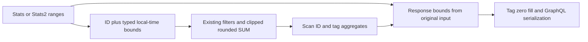
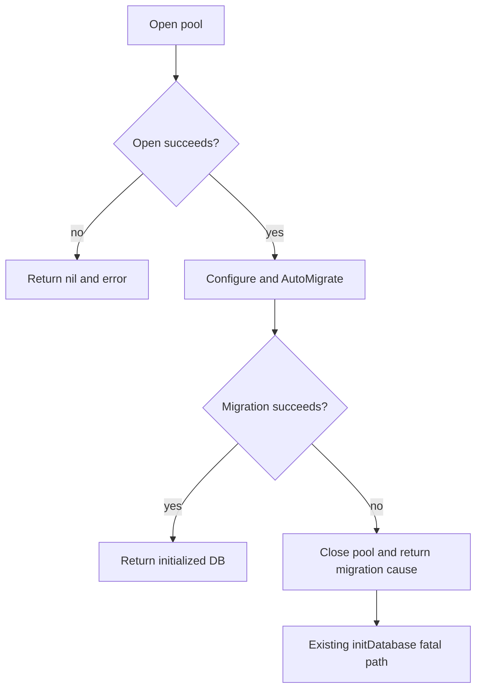

# Implementation plan: PostgreSQL dashboard review remediation

**Mission**: postgres-dashboard-review-fixes-01M5ZJTF | **Date**: 2026-10-28 (Europe/Samara)
**Spec**: [spec.md](spec.md) | **Planning/base and merge target**: `plan/postgres-dashboard`
**Status**: Design authored; implementation and executable acceptance pending.

## Summary and engineering alignment

Fix four scoped defects within existing boundaries: disposable launcher, statistics grouping, timestamp serialization, and production database initialization. Preserve schema/API fields, local-time semantics, integer behavior, per-span rounding and text/bytea persistence. The spec supplies engines, precision, cleanup invariants, acceptance and operational boundaries; no product question remains unresolved. Decisions derive from repository inspection at `eb57894caf93636aedcb9e6eda797b26e245b0db`, not fresh execution. See [research.md](research.md), [data-model.md](data-model.md), [contracts/remediation.md](contracts/remediation.md), and [quickstart.md](quickstart.md).

## Technical Context

**Language/Version**: Go 1.24.0 module baseline; CI Go 1.25.x; Bash; existing React 16 / TypeScript 3 UI.
**Primary Dependencies**: GORM v1.9.2, lib/pq v1.0.0, go-sqlite3 v1.10.0, gqlgen v0.17.85; retain dependencies and lockfiles.
**Storage**: Disposable SQLite and actual PostgreSQL major 17, including text and legacy bytea enum columns.
**Testing**: Go/testify real-engine fixtures; shell command doubles and actual Docker lifecycle; serialized GraphQL; full lint/race/coverage/frontend pipeline.
**Target Platform**: Existing Linux application and Ubuntu GitHub Actions host runner with Docker.
**Project Type**: Go web application with embedded React assets.
**Performance Goals**: Retain one aggregate query per Stats call; no per-range database round trips.
**Constraints**: C-001–004; no ORM upgrade, destructive schema conversion, deployment, production access, image publication, external manifest edits or closing task 114.
**Scale/Scope**: Four defects plus necessary tests, gate wiring and evidence reconciliation; no general range-order redesign.

## Charter Check

Action context loaded with `spec-kitty charter context --action plan --mission-type software-dev --json`. Project charter absent: project-specific check skipped before and after design. Builtin locality, decision traceability, spec fidelity and documentation guidance consulted. No dependency additions/upgrades/removals; dependency-change research/challenge requirements are inapplicable. No governance setup is introduced.

## Project structure and boundaries

| Surface | Responsibility |
| --- | --- |
| statistics/summary.go and summary*_test.go | Query identity, grouping and shared engine fixtures |
| statistics/summary2.go | Existing selection-to-Stats delegation; preserve builder |
| model/time.go and time_test.go | Accepted timestamp precision on response wire |
| database/database.go and *_test.go | Initialization, migration failure, pool ownership |
| main.go and main_test.go | Existing fatal startup boundary |
| test/postgres.go and *_test.go | Isolated databases, required mode and harness comments |
| hack/test-databases.sh; proposed hack/test-databases_test.sh | Launcher and executable regressions |
| Makefile; .github/workflows/build.yml | Mandatory suite coverage and CI integration |
| docs/reviews; parent mission review/acceptance artifacts | Shared evidence and historical reconciliation |

All paths are repository-relative. Planning artifacts stay in this mission directory; tasks are a separate phase.

## Range identity and precision — FR-003/005

Add an integer range_id to each parameterized dates CTE row alongside existing typed start/end bounds. Include ID in SQL grouping and scan ID plus tag/value/seconds. Rebuild response bounds from original Go input, independent of DB timestamp representation. Replace boundStartExpr/boundEndExpr and string-bound statReturn/group reconstruction after confirming usages. Initialize response ranges with existing empty-entry shape, attach aggregates by ID, then preserve tag zero fill.

Keep PostgreSQL timestamptz casts, OmitTimeZone, overlap predicates, completed-span behavior, Include/Exclude and user isolation. Preserve both duration expressions and per-span rounding. DB-native precision still governs SQL arithmetic; it must not govern identity. Fine-precision regression expectations stay away from half-second thresholds. Keep established ordered-input behavior; unsorted-range characterization remains follow-up. Identical duplicate ranges must not double their aggregates.

model.Time accepts fractions and retains nanoseconds but MarshalGQL uses RFC3339. Use RFC3339Nano serialization to satisfy original-bound preservation through the API. Whole-second strings and schema remain unchanged. Add scalar round-trip and real serialized GraphQL response assertions alongside resolver tests. Stats2 keeps existing relative/static parsing and second-inclusive daily builder; cover fractional inputs where that existing path supports them, without parser expansion.

## Migration failure and resource ownership — FR-004/005

Check AutoMigrate(model.All()...).Error in production database.New. On failure close the opened pool and return nil plus wrapped migration cause; cleanup failure must not replace that cause. Emit initialization success only after migration succeeds. Keep New's signature and model.All's existing foreign-key order.

Create real migration failures after successful connection on both engines: first candidate is a view named users blocking required table creation in an isolated empty DB. Verify GORM introspection actually reaches the intended failure; use an equivalent schema conflict if needed. A bad DSN is not migration coverage. Public-New PostgreSQL tests belong to external database_test package to avoid database → test → database cycles. A narrow internal post-open initialization seam may expose the owned pool to cleanup assertions and controlled close-failure testing; real public-New engine tests remain mandatory. Prove pool closure via retained pool Ping failure and/or PostgreSQL session observation, not closure of an unrelated fixture connection.

Exercise initDatabase's zerolog Fatal in a subprocess: nonzero exit and no default-user/startup success after migration error. Avoid broad main refactors. Restore mutable test hooks, including existing mkdirAll override, to keep tests order independent. Remove redundant harness migrations once production New owns failure; correct stale ordering comments. Retain healthy fresh/reopen, text/bytea read/write and enum physical-column checks.

## Safe launcher and CI gate — FR-001/002/005/006

Publish explicitly with `127.0.0.1:${PORT}:5432`; preserve custom ports, health checks, cleanup trap and supplied-DSN reuse. Remove credential-bearing DSN echo. Pass connection configuration through environment; retain fixed stage messages and original exit status. Exercise URL and quoted keyword sentinels on success, malformed-input/setup failure and test failure, including child-emitted credentials. Remove secret-bearing error output at its source where possible; if launcher-controlled replay needs redaction, capture privately, redact supported DSN forms before replay, and clean temporary files on all exits. Whitespace-splitting keyword passwords is insufficient. Never enable shell tracing.

Replace the postgres-test CI service-container setup with the same self-launch path via make test-postgres on its Ubuntu host runner. Remove hardcoded service DSN; the launcher owns loopback publishing, health/version checks and cleanup. This avoids maintaining two distinct publishing/lifecycle implementations. Preserve existing build/release behavior. Require actual server_version_num major 17 for the dedicated gate; default postgres:17 configuration alone is insufficient. Other-major overrides fail that gate.

Add ./database/... and ./model/... to PG_PACKAGES. Keep required-mode missing/unusable DSN failures and ensure any skipped PostgreSQL cases fail the dedicated run; retain verbose/JSON output with PG execution and skip counts. Wire proposed launcher regressions into an explicit Makefile target run by CI. Real integration must inspect all published HostIp values (only 127.0.0.1), prove connection, exercise custom host port and observe container removal after success and induced failure.

## Verification and reconciliation — FR-006/007

Follow quickstart.md after implementation. First show new regressions distinguish reviewed defects, then execute fresh SQLite, required actual PG17 with no PG skips, make lint and make test after generation and real UI build preparation. Inspect goimports filenames even if exit is zero. Record backend race/coverage and frontend outcomes. Missing tools/services remain unresolved verification.

Create docs/reviews/postgres-dashboard-remediation-evidence-<date>.md with tested code commit, any dirty-patch identity, tool versions, actual server version, sanitized commands/log references, exits and test/skip counts. Prefer a committed code revision before acceptance; later docs-only commits reference it explicitly. Post-test code changes invalidate affected evidence.

Append dated addenda to both source reports, mapping every source-local finding using spec's reconciliation table to common evidence and scoped verdict. Preserve historical verdicts and execution records. Amend affected parent acceptance provenance using actual status events; recorded tool/user identities do not prove independent human review. Keep F-5 hardening and F-6 operational delivery explicitly deferred and task 114 open. No current review verdict changes during planning.

## Implementation Concern Map

Concerns are architecture boundaries, not executable work packages.

| ID | Purpose / requirements | Surfaces | Dependencies | Main risk |
| --- | --- | --- | --- | --- |
| IC-01 | Loopback and credential-safe execution; FR-001/002/005 | launcher, shell regressions, workflow | None | Failure output leaks; CI divergence |
| IC-02 | Lossless range identity and serialization; FR-003/005 | statistics, model/time, GraphQL tests | None | DB precision, rounding and zero fill |
| IC-03 | Startup migration error and cleanup; FR-004/005 | database, main tests, test harness | None | Real failure fixture and ownership assertions |
| IC-04 | Mandatory coverage and complete evidence; FR-005/006 | package list, gates, execution records | IC-01/02/03 | Green runs with skips or missing preparation |
| IC-05 | Consistent review disposition; FR-007 | both reports, acceptance, shared evidence | IC-04 | Historical evidence/attribution conflation |

## Risks and rollout

No data migration or new infrastructure. Existing AutoMigrate remains; text/bytea shapes must reopen without conversion. Rollout is source delivery and evidence only; deployment belongs to a separately authorized operational workflow. A source revert restores the defects and is not successful remediation.

| Risk | Control |
| --- | --- |
| Resolver precision fixed but wire still truncates | Scalar and serialized GraphQL assertions |
| Grouping changes totals/local time | Shared integer/fraction fixtures and non-UTC PG session tests |
| Initialization test only exercises open failure | Prove connection and real production migration failure, then owned pool cleanup |
| Keyword credentials leak on failure | Captured stdout/stderr sentinel cases including quoted values and child failure |
| Incomplete environment masquerades as verification | Retain failures and block closure until actual PG17/full pipeline execution |
| Legacy formatting/frontend failures | Resolve required findings, document necessary changes and rerun acceptance |

Next phase is /spec-kitty.tasks when explicitly invoked. Planning/base and final merge target are both plan/postgres-dashboard, matching setup output. No implementation or fresh passing acceptance is claimed.
